# Dashboard guide: what everything does

RESPONDA shows the August 2018 Kerala flood week (Day 1 = 18 Aug to Day 7 = 24 Aug) as a relief coordinator would see it, using the results of Steps 1-6 served by the backend (FastAPI + PostGIS).

**Layout.** The sidebar on the left has the nine pages. Each page has a big title at the top and, on the right, the **day picker**: changing the day updates every page that shows "today". On a phone the sidebar becomes a scrollable bar at the top.

**Colour themes.** Under **THEME** at the bottom of the sidebar you can switch between four colour schemes: **Navy** (default), **Ocean** (dark teal), **Graphite** (charcoal with violet) and **Daylight** (light, good for projectors and printing). The browser remembers your choice. Switching theme resets the page you are on, so pick it before starting a simulation.

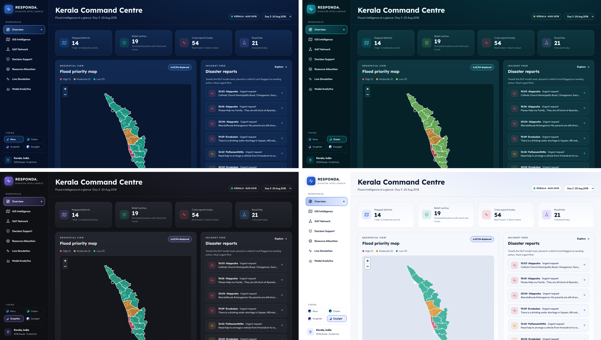

**Words used everywhere**

| Word | Meaning |
|---|---|
| Flood priority | The district's severity score from the GAT (Step 2): 50% predicted demand, 30% 100-year flood exposure, 20% social vulnerability. **High** ≥ 0.5, **Moderate** ≥ 0.3, otherwise **Low**. |
| Need / demand | Food kits, water (litres), medicine kits and rescue teams a district needs that day. |
| Need met / demand met | Share of the need that was actually delivered. |
| Worst-off district | The district with the lowest need met. Our fairness measure. |
| Gini | Fairness gap between districts: 0 = every district gets the same share, higher = less fair. |
| AI agents | The 19 relief centres running the trained multi-agent PPO policy with the fairness term (Step 4). |
| Optimiser | The OR-Tools linear programme baselines (Step 3). |
| Dispatch wave | The reallocation loop (Step 6) replans four times a day: 06:00, 12:00, 18:00, 24:00. |

---

## 1. Overview: "Kerala Command Centre"

- **Four cards:** mapped districts (with how many are High / Moderate today), relief centres, crisis reports today (real tweets and alerts raised), road links (how many are blocked today).
- **Flood priority map:** districts coloured High (red), Moderate (amber), Low (teal). Hover for details.
- **Incident feed:** the day's real crisis tweets that the system acted on, most urgent first, with district, time, category and urgency. Click one to open it in **Decision Support**.

## 2. GIS Intelligence

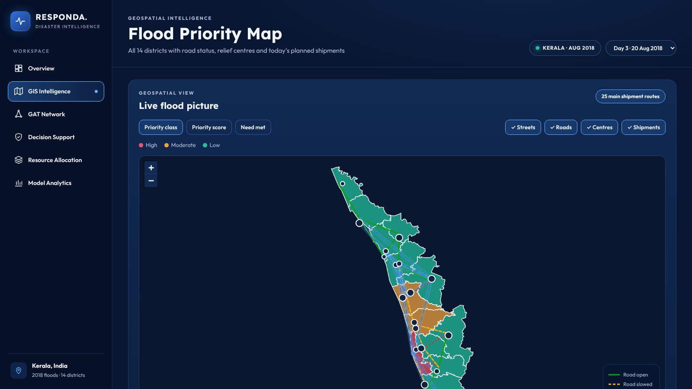

- **Map layers:** switch the street map, roads, relief centres and shipments on or off. Roads show today's status (blocked red dashed, slowed amber). Shipments are glowing blue lines from centre to district.
- **Colour districts by:** flood priority class, severity score, or need met (how much of today's need the AI agents' plan ships; a pale district is being left behind).
- **Day timeline with ▶ play:** steps through the week so you can watch the flood rise and fall.
- **District status table:** every district's priority class, score, displaced people and how much of its need the plan covers that day.
- **Event log:** everything the reallocation loop (Step 6) did that day in time order: real tweets, road changes, the four dispatch waves and the alerts they raised. The buttons filter by type (reports are hidden at first because there are many).

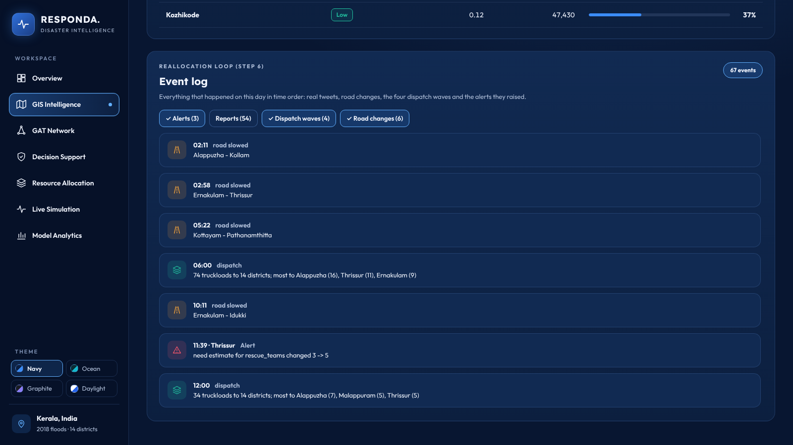

- **Route planner (rescue routing):** choose a destination district and either a specific relief centre or "Fastest centre that has…" a resource (rescue teams by default). It finds the fastest route that is open on the chosen day over the district road network: blocked roads are skipped, slowed roads count at their flood travel time, plus about 1 hour of local delivery. You get the centre to send from, travel time today vs on normal roads, distance, the districts crossed, a table of road links with their status, a note when the usual route is cut and a detour is used, and the next fastest centres. The map draws the route along real streets using the free OpenStreetMap router (OSRM, no key needed); if that router can't be reached, it is drawn as straight lines between district HQs. Changing the day re-plans it. You can also open it from **Decision Support** ("Show route on map" on any shipment) and **Live Operations** ("Plan rescue route").
- *Limit:* flood closures are known per district-to-district road link (Step 6 road events), so the planner avoids a whole flooded link; the street-level path inside a link comes from normal OpenStreetMap roads and doesn't know which individual streets are under water.

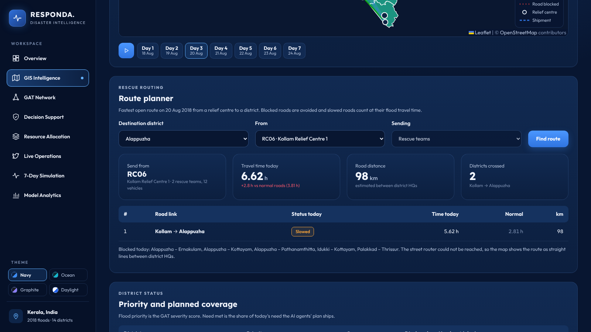

## 3. GAT Network

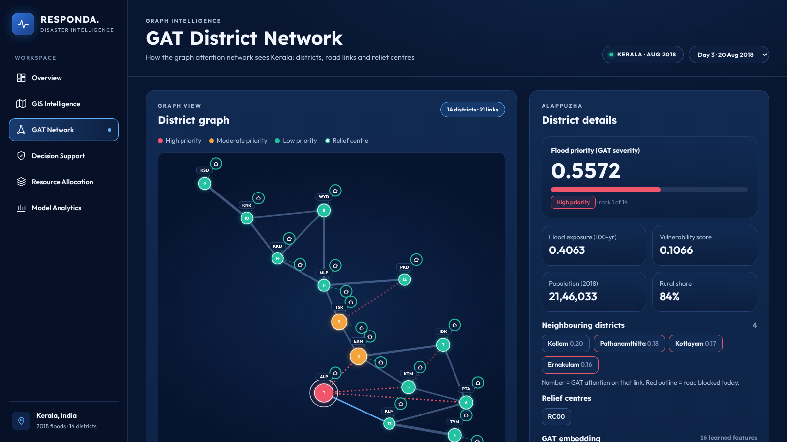

The graph the GAT model actually works on: 14 district nodes, 21 road links and the 19 relief centres.

- **Node colour and size:** flood priority; the number inside is today's priority rank.
- **Link width:** how much attention the GAT pays to that neighbour (learned in Step 2). Red dashed = road blocked today.
- **Small house icons:** relief centres, joined to their home district.
- **Click a district** to see its details on the right: priority score and rank, flood exposure, vulnerability, population, rural share, its neighbours (with attention; red outline = road blocked), its relief centres, and its **GAT embedding**: the 16 hidden features the network computed for that district on that day before predicting tomorrow's demand.

## 4. Decision Support

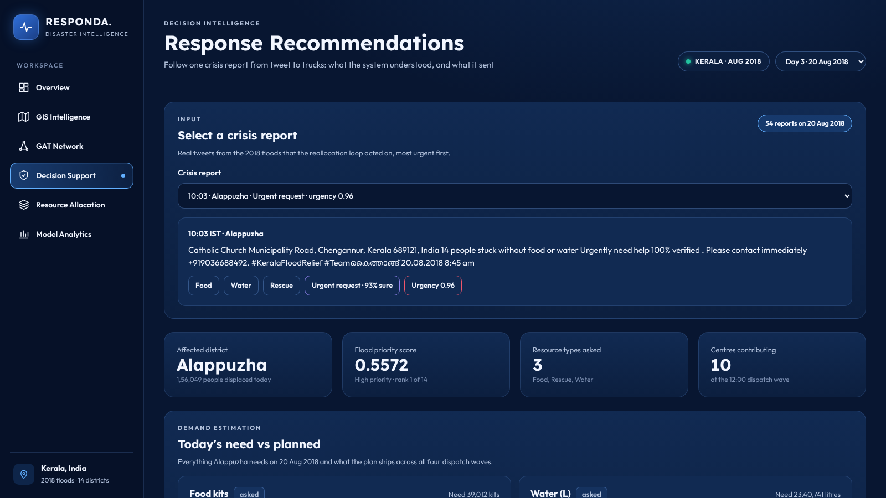

Follows one crisis report from tweet to trucks.

1. **Select a crisis report:** real tweets from that day the reallocation loop acted on, most urgent first. You see the text, needs found, category, model confidence and urgency.
2. **Four cards:** affected district (people displaced), flood priority and rank, resource types asked, how many centres contributed at the next wave.
3. **Today's need vs planned:** per resource, the district's need and how much the plan ships across all four waves.
4. **Shipments at the next wave:** which centres sent what to that district at the first dispatch after the report, nearest first, with road hops and travel time.
5. **How the district fares under each strategy:** share of its need met over the whole week, AI agents vs the other strategies.
6. **Why was this decision recommended?** Six plain-language steps: NLP reading, location, demand update, GAT priority, allocation, fairness check.

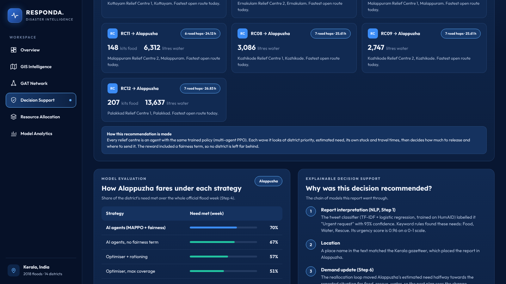

## 5. Resource Allocation

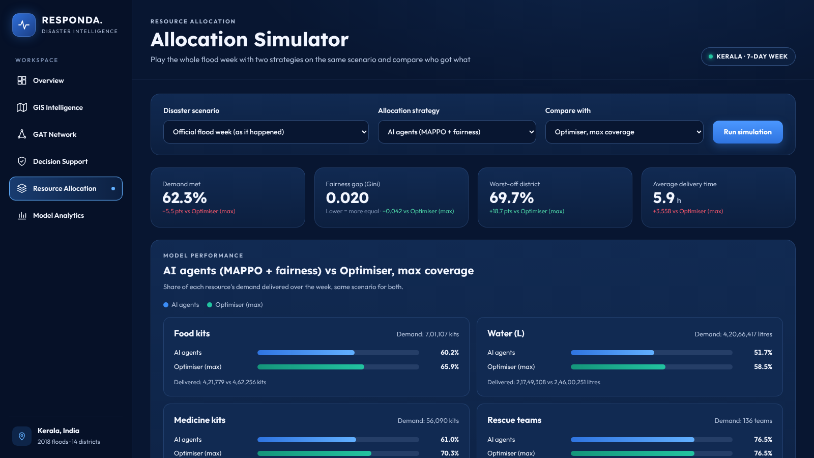

The allocation simulator: plays the whole flood week with two strategies on the same scenario.

- **Scenario:** official week as it happened, supply shortage (half the stock), bigger flood (+50% demand), main roads cut (Alappuzha–Ernakulam and Ernakulam–Thrissur), worst case (half stock and +50% demand), or **Custom what-if**: set the stock (20-200%) and demand (50-250%) with sliders and click any roads to close them for the whole week.
- **Strategy** and **Compare with:** any of AI agents, the three optimisers, greedy by severity, local-first. Default: AI agents vs optimiser + rationing.
- **Cards:** demand met, worst-off district, fairness gap (Gini) and average delivery time, each with the difference from the comparison strategy.
- **Delivered and unmet resources:** per resource, both strategies side by side.
- **Daily chart:** demand met per day for both.
- **District-level allocation analysis:** every district's need met, switchable between the two strategies and between resources.
- **Allocation summary** and **disaster event timeline:** what changed each day (demand surges, roads blocked, slowed or reopened) that both strategies had to replan around.

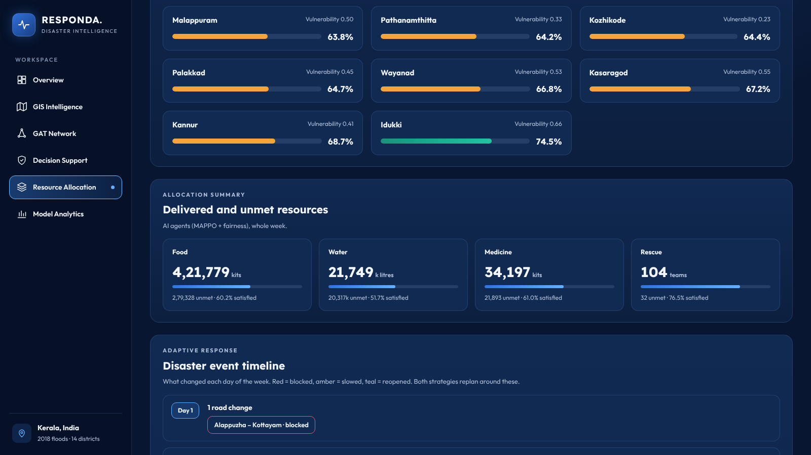

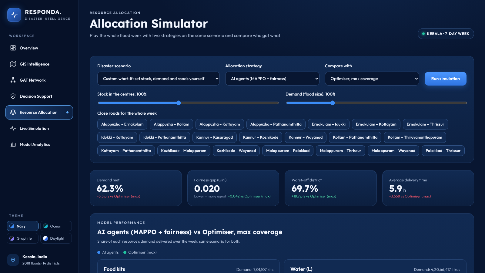

## 5a. Operations Desk (run the week by hand)

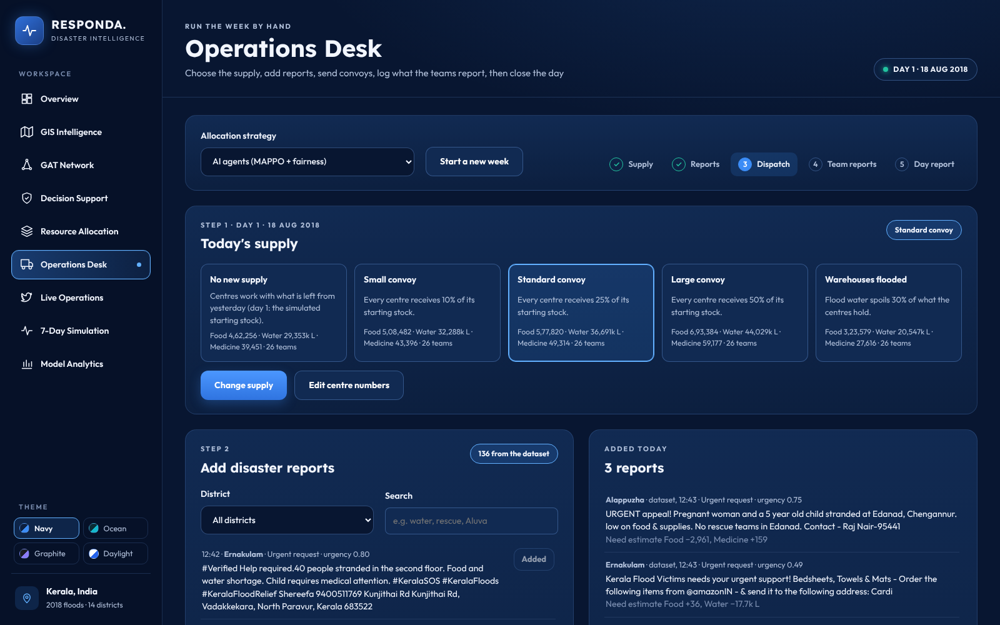

The flood week run one day at a time, where nothing happens until you do it. The same allocation models are used as everywhere else (AI agents with the fairness reward, or the optimiser with rationing), with the same stock, trucks, roads and true need.

1. **Today's supply.** Pick one of the simulated options for the 19 relief centres: *No new supply* (what is left from yesterday; on day 1 the simulated starting stock), *Small*, *Standard* or *Large convoy* (each centre receives 10%, 25% or 50% of its starting stock), or *Warehouses flooded* (30% of what the centres hold is spoiled). **Edit centre numbers** lets you change any centre's food, water, medicine, rescue teams and vehicles before confirming. The supply can be changed until the first wave leaves.
2. **Add disaster reports.** The list shows that day's crisis tweets from the dataset (the 449 located, actionable HumAID tweets of the flood week), filterable by district or word. **Add** one and the planner's estimate of that district's need moves halfway toward the true need (the Step 6 rule, so it can go up or down). You can also type a new report: the Step 1 model reads it and the people it mentions become new need, with nearby centres releasing extra stock. Without reports the planner works from the morning forecast.
3. **Dispatch.** The table previews the next wave (06:00, 12:00, 18:00, 24:00): one convoy per district, the supplies from all contributing centres and when it arrives over today's roads. **Send wave** turns it into operations. Each wave is planned with the stock, trucks and estimate at that moment.
4. **Team reports.** Every operation waits for its rescue team's report: **✓ Success** counts its supplies as delivered; **✗ Fail** (with a reason: road impassable, area flooded, vehicle breakdown, wrong location, supplies damaged, team diverted, other) sends the supplies back to the centres, leaves the need open, and the next wave plans it again. **Mark all waiting as succeeded** and **Simulate team reports** (failures likelier on slowed roads and long trips) fill in many at once.
5. **Close the day.** The day report: need met (only confirmed deliveries count, against the true need), worst-off district, fairness gap (Gini), operations succeeded, failures by reason, supplies returned, and every district's need met and operations. Missing team reports can be counted as failed. Leftover stock carries over and the next day starts at step 1. **Week so far** adds the days up with the same formulas as Steps 3-6.

Everything (supply choices, reports, operations, team reports, day reports) is saved in the database tables `ops_log`, `ops_operations` and `ops_day_reports`, which a reload keeps. **Download the operations log (CSV)** exports a session's operations.

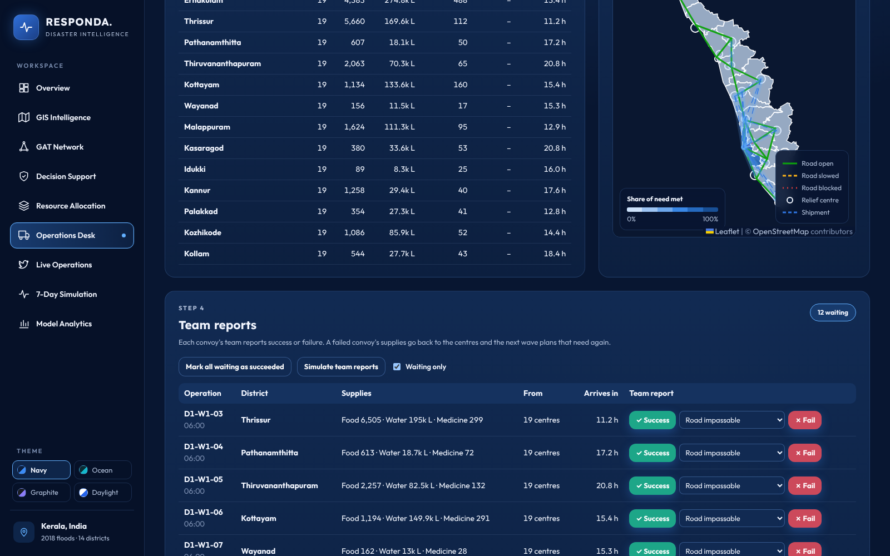

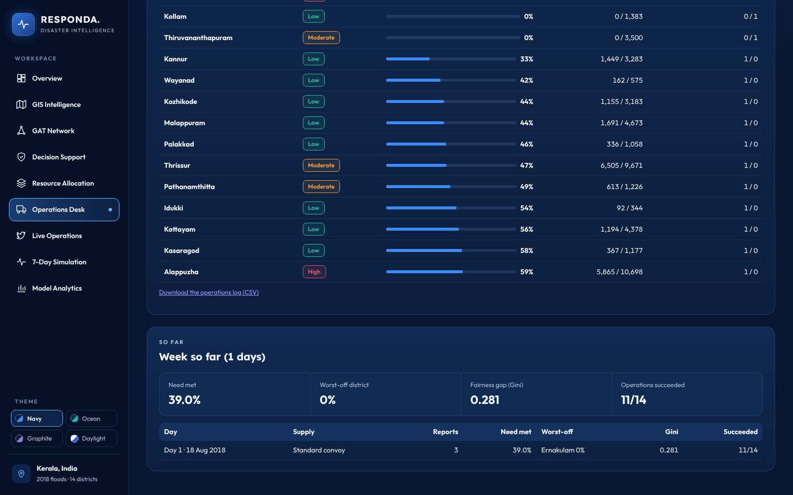

## 5b. Live Operations (new reports arriving)

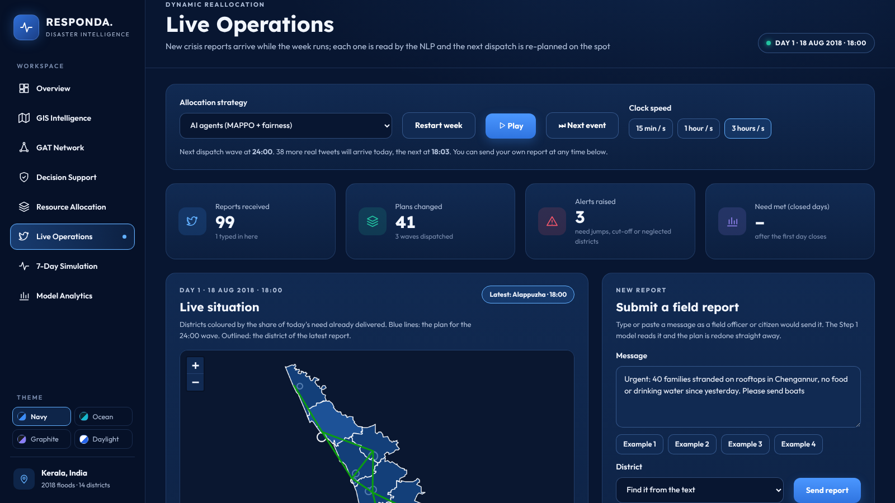

The week runs on a clock, crisis reports keep arriving, and the allocation is redone after every one. This is the Step 6 reallocation loop running live: played to the end with no typed reports, it gives exactly the Step 6 result (58.3% of need met on the official week, AI agents).

**Controls:** pick the strategy (AI agents or Optimiser + rationing), **Play / Pause**, the **clock speed** (15 minutes, 1 hour or 3 hours of flood time per second), **Next event** to jump to the next report, road change or dispatch wave, and **Restart week**.

**Where reports come from**
- **Real tweets (replay):** the 449 flood-week tweets arrive at the time they were posted. Each one moves the planner's estimate of that district's need halfway to the true need (the Step 6 rule).
- **Field reports you type:** write or paste any message in **Submit a field report** (or click an example) and press **Send report**. The Step 1 model reads it on the spot: category and confidence, urgency, needs, and the district (from a place name such as Chengannur or Aluva, or the district you choose). The number of people it mentions ("40 families" = 160 people) becomes new need in that district: food 1 kit per 4 people, 15 L of water per person, 1 medicine kit per 50 people, and a rescue team when rescue is asked. If no number is given, the head count is estimated from the urgency. Because the day's stock budget was fixed in the morning, the nearest centres that can still reach the district release that much extra from their reserve.

**What happens next:** the next dispatch wave (06:00, 12:00, 18:00 or 24:00) is re-planned straight away with the stock and trucks left. Reports with urgency 0.7 or more also raise an alert.

**What you see**
- **Cards:** reports received, how many events changed the plan, alerts, and need met over the days closed so far.
- **Live situation map:** districts coloured by how much of today's need has been delivered, the next wave's shipments, today's roads, and the district of the latest report outlined.
- **Live feed:** every tweet, field report, road change, dispatch and alert as it happens, filterable. "plan changed · N" marks events that moved shipments. Click one to see its effect.
- **How the plan changed:** for the selected event, the shipments of the next wave just before and just after it (centre, district, resource, before, after), with totals per district. A real tweet can also be opened in Decision Support.
- **District picture right now:** for each district, the morning forecast, the planner's current estimate, the true need, what was sent today and the next wave (food kits), plus stock left and the closed days.

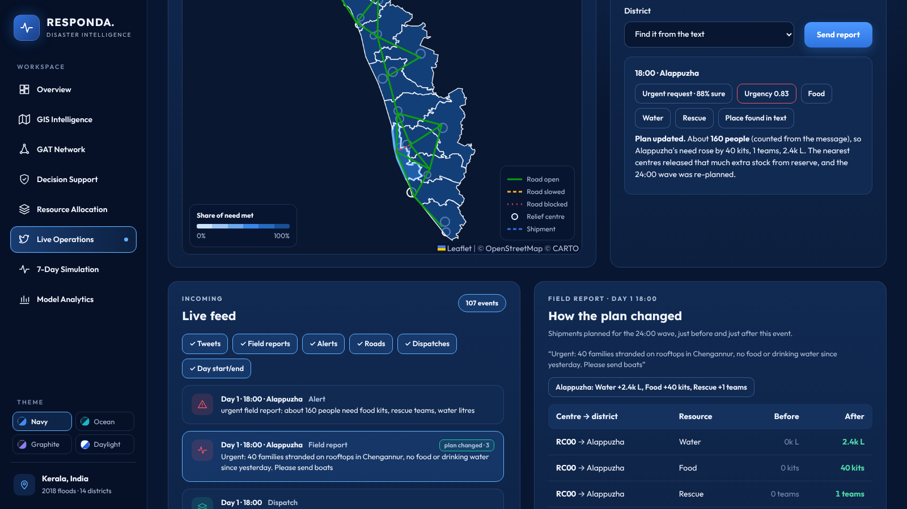

## 5c. 7-Day Simulation

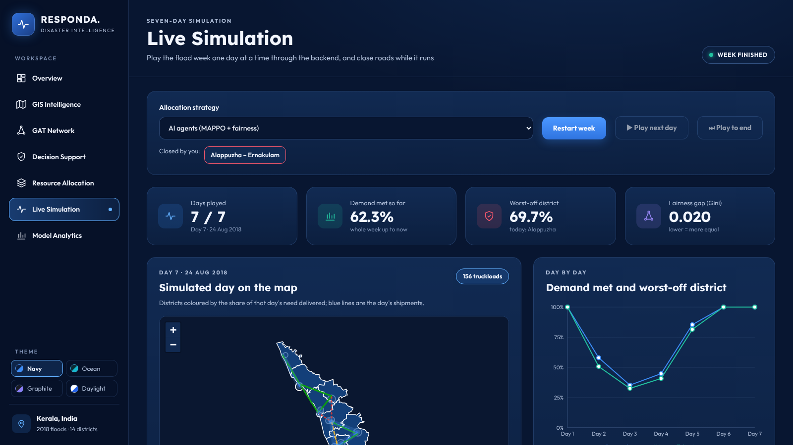

Plays the official flood week one day at a time through the backend, like a real control room would.

1. Pick a **strategy** and press **Start week**.
2. Press **▶ Play day N** to run one day, or **⏭ Play to end** to run the rest of the week.
3. While the week is running you can **close any road from today on** (a live what-if). Closed roads are listed under the buttons.

What you see:
- **Cards:** days played, demand met so far, worst-off district, fairness gap (Gini), all for the week up to now.
- **Map:** the latest simulated day, districts coloured by how much of that day's need was delivered, with the day's shipments and road status.
- **Day by day chart:** demand met and the worst-off district for each day played.
- **Stock left in all centres:** how much food, water, medicine and rescue teams remain.
- **Day-by-day results:** a row per day with need met, worst-off district, truckloads and average delay.
- **District coverage today:** every district's share of need delivered on the latest day, lowest first.

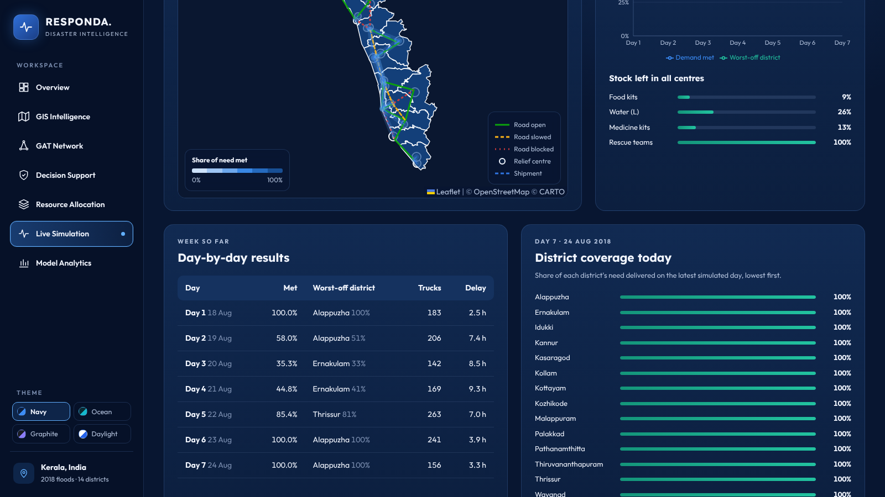

## 6. Model Analytics

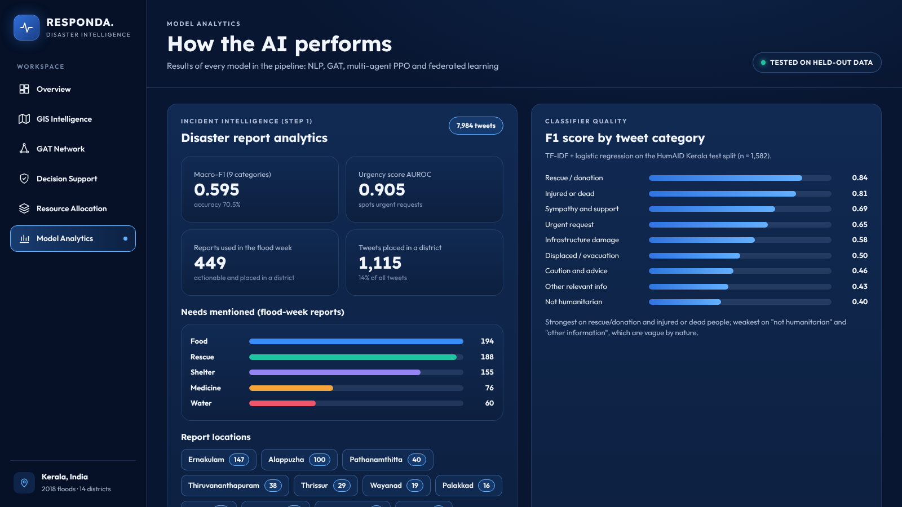

- **Disaster report analytics (Step 1):** classifier macro-F1 and accuracy, urgency AUROC, how many tweets were placed in a district, needs mentioned, where reports came from; **F1 by tweet category**.
- **GAT demand forecast error (Step 2):** error of persistence, MLP, GCN and GAT on later days or unseen districts, and the strongest learned attention links.
- **Training reward (Step 4):** MAPPO learning curves for the three fairness settings.
- **Which allocation strategy works best? (Steps 3-6):** the full comparison over 50 unseen flood weeks: demand met, worst-off district, Gini.
- **Federated learning (Step 5):** 19 centres training with Flower FedAvg, federated vs centralised vs independent models, and fairness over the training rounds.

## Phone

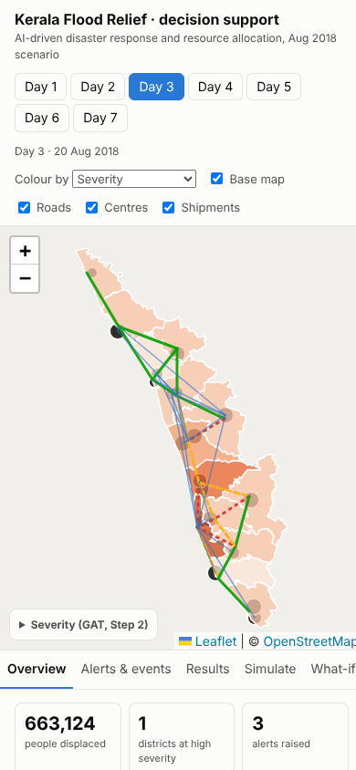

---

*The base map is OpenStreetMap (no API key; dimmed automatically in the dark themes). Screenshots were taken without map tiles or the street router (not reachable from the build machine); with internet the street map shows under the districts and routes follow the streets.*
