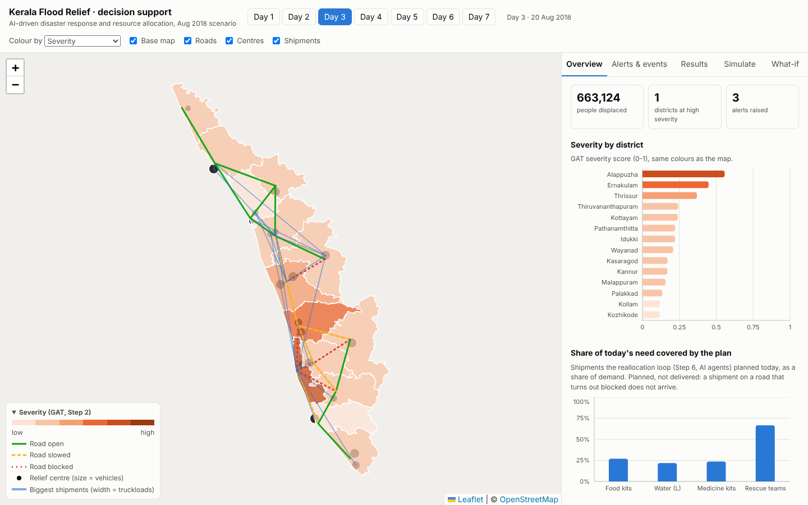

# Step 8: dashboard (React + Leaflet + Recharts)

RESPONDA, a decision-support dashboard for the Kerala 2018 flood scenario. It reads everything from the Step 7 backend.



## Run it

You need Node.js 18+ and the backend running (see `backend/README.md`).

```
cd frontend
npm install
npm run dev          # http://localhost:5173
```

The backend address defaults to `http://localhost:8000`. To change it, copy `.env.example` to `.env` and edit `VITE_API_URL`.

## Pages

Sidebar layout with eight pages and four colour themes (Navy, Ocean, Graphite, Daylight; picker at the bottom of the sidebar, saved in the browser). The day picker at the top right switches the whole dashboard between 18 and 24 Aug 2018. A full walk-through is in `docs/dashboard-guide.md`.

| Page | Shows |
|---|---|
| Overview | Kerala Command Centre: districts, centres, reports and blocked roads today; flood priority map (High / Moderate / Low); live incident feed of real tweets |
| GIS Intelligence | Large map with layer toggles (centres, roads, shipments), colour by priority, severity or need met, day-by-day playback, district status table, filterable Step 6 event log |
| GAT Network | The district graph the GAT uses: nodes sized by priority, link width = learned attention, blocked roads, relief centres; click a district for its details and 16-feature GAT embedding |
| Decision Support | Pick a real crisis tweet and follow it: what the NLP understood, the district's need vs plan, which centres shipped what at the next wave, coverage under each strategy, and a six-step explanation |
| Resource Allocation | Run a scenario (official week, stock shortage, demand surge, roads cut, worst case, or a custom what-if with stock/demand sliders and road closures) with any strategy against a baseline: demand met, worst-off district, per-resource and per-district results, daily chart, event timeline |
| Live Operations | Dynamic reallocation: the week runs on a clock, real tweets arrive at their posting time and you can type new field reports; each is read by the NLP and the next dispatch is re-planned, with a before/after list of changed shipments |
| 7-Day Simulation | The seven-day simulation: start a week with any strategy, play it day by day, close roads while it runs; map, daily chart, stock left, per-day and per-district results |
| Model Analytics | NLP report analytics and F1 by category, GAT forecast error and attention, MAPPO training curves, strategy comparison, federated learning |

Works on phones too (sidebar becomes a top bar).

## Screenshots

`docs/screenshots/`: one per page plus the decision explanation, district-level allocation and mobile. They were taken without the map tiles, which aren't reachable from the build machine; on a normal internet connection the base map shows under the districts.

## Files

```
src/api.js            backend calls
src/constants.js      days, resources, labels, colours, strategies
src/theme.js          chart colour helpers (read the active theme's CSS tokens)
src/App.jsx           sidebar, page routing (#page), shared day data
src/components/       MapView, ComparePanel, ui (cards, stats, meters), icons
src/pages/            Overview, Gis, Network, Decision, Allocation, LiveOps, Simulation, Analytics
```
